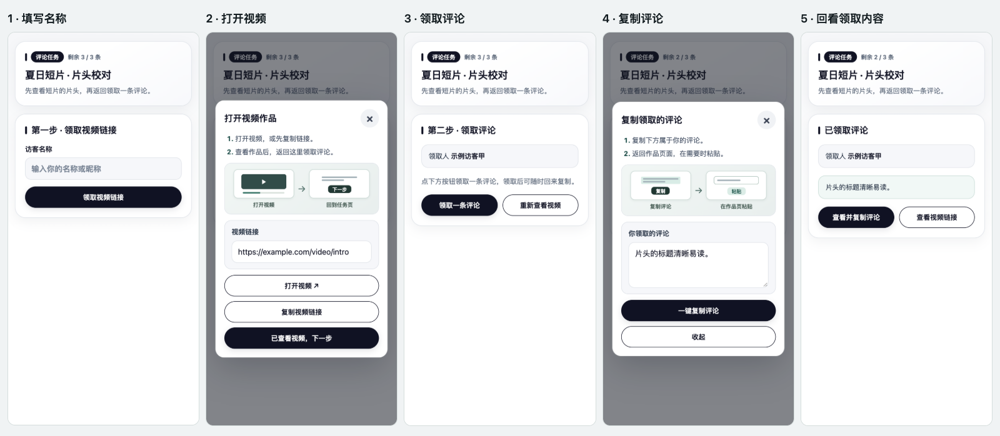
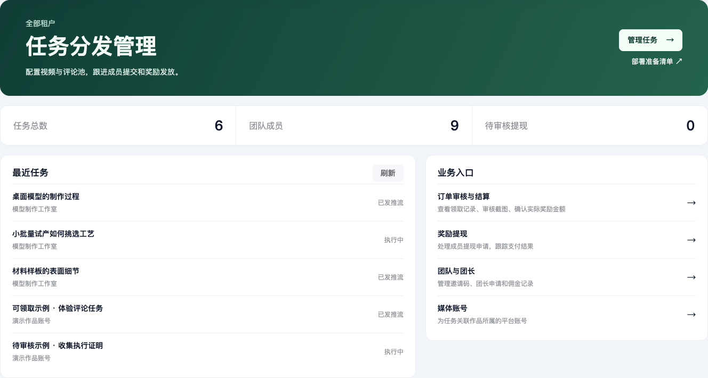

# 快火任务分发

本仓库提供自媒体视频评论生成和热启动任务分发。需要从视频文案准备评论时，先用下面的评论生成工作台。手里已有作品链接和评论时，可以直接选择[免登录评论版](no-login-version/README.md)或[登录完整版](login-version/README.md)。

## 自媒体视频评论生成

工作台支持为**抖音、小红书、快手**分别生成评论草稿。每条作品可以选择归属的视频账号，沿用该账号的行业、受众和说话风格，再按平台填写评论条数、讨论重点、必用词、可选词和避开词，也可以指定作者回复条数。[工作台源码](comment-generation/) · [提示词与写作指南](comment-generation/comment-studio/resources/)

| 想做什么 | 需要准备什么 |
| --- | --- |
| 用已有文案预览提示词 | Python 3.9 或以上版本、浏览器和一段口播或字幕。这一步可以离线完成。 |
| 在工作台直接生成评论 | 在「服务状态」配置千问、DeepSeek 或火山方舟其中一家的 API Key 和可用模型 ID。 |
| 从作品链接提取文案 | 视频解析服务、FFmpeg、FFprobe，以及本机或云端语音识别服务。取得文案后可预览提示词或调用文本模型。[配置示例](comment-generation/comment-studio/.env.example) |

### 先用一段文案试跑

在仓库首页点 **Code → Download ZIP** 并解压，或用 Git 克隆仓库。从仓库根目录运行下面的命令。

```sh
cd comment-generation
python3 comment-studio/server.py
```

Windows 可将第二行换成 `py -3 comment-studio/server.py`。打开 [本机工作台](http://127.0.0.1:8766/)，点「手动写文案」，例如粘贴“这批外壳先打 20 件样，确认卡扣尺寸后再开模”。选抖音 5 条，把“卡扣”填入「必用原词」，点「预览与复制提示词」。配置好模型后，就可以用同一份文案直接生成草稿。

### 从生成结果创建热启动任务

要让访客领取评论，使用 `comment-generation/` 随附的工作台和分发服务。发布者使用同一账号管理生成和热启动，两个服务共用一份 SQLite 数据库。若上一步的独立工作台正在运行，先按 `Ctrl+C` 停止它。

**本机启动统一模式**（macOS / Linux）。打开两个终端，分别从仓库根目录运行。

**终端一**启动访客领取服务。

```sh
cd comment-generation
mkdir -p .dev-data
export COMMENT_SHARED_DB="$PWD/.dev-data/shared.sqlite3"
python3 dispatch/run.py --port 8780 --data-dir "$PWD/.dev-data/dispatch"
```

**终端二**启动发布者工作台。

```sh
cd comment-generation
export COMMENT_SHARED_DB="$PWD/.dev-data/shared.sqlite3"
export COMMENT_DATA_DIR="$PWD/.dev-data/studio"
export COMMENT_PUBLIC_ORIGIN=http://127.0.0.1:8766
export COMMENT_DISPATCH_PUBLIC_ORIGIN=http://127.0.0.1:8780
python3 comment-studio/server.py
```

1. **整理评论。** 在 8766 工作台注册或登录发布者账号。生成完成后，在目标平台点「管理评论」，逐条编辑、删减，或按行粘贴。也支持 Excel 导入和导出。导入时在第一张工作表用「评论内容」作为列名，每行一条。
2. **创建草稿。** 点「创建热启动」，工作台会带入作品标题、目标平台和该平台的主评论。用同平台链接生成时会沿用原分享内容。手填文案或跨平台分发时，在草稿中补上对应作品的分享链接。
3. **发布和领取。** 核对草稿后点发布，复制该任务专属的领取链接。本机体验时，用另一个浏览器打开链接，填写昵称并按页面指引领取。发布者可在工作台查看已领数量和剩余评论。

**已有评论时**，可以直接在「任务管理」点「导入评论创建热启动」，填写作品资料并导入评论，然后发布领取链接。

要让其他设备通过链接领取，请为发布者工作台和访客领取服务配置可访问的 HTTPS 地址。管理员首次设置密码、模型用量预算和链接解析的详细步骤见[评论生成工作台运行说明](comment-generation/README.md)。

## 独立任务分发版本

| | [免登录评论版](no-login-version/README.md) | [登录完整版](login-version/README.md) |
| --- | --- | --- |
| 适合的业务 | 把准备好的评论逐条分给访客 | 管理团队任务、执行证明、审核、结算与提现 |
| 参与者怎么用 | 打开分享链接 → 填名称领视频 → 领一条评论并复制 | 登录并加入团队 → 领视频和评论 → 交证明 → 查审核结果和钱包 |
| 发布者怎么用 | 填作品链接及评论池、发布、复制领取链接、看领取明细 | 在专用 PC 后台建任务、维护评论池、限定团队、审核订单及提现 |
| 本地运行环境 | Python 3.9+，数据保存在 SQLite | Python 3.9+、Docker Engine 和 Compose v2，或自行运行 Node.js、PostgreSQL 和 Redis |
| 默认本机地址 | 访客和管理端均使用 8780，终端给出发布者入口 | 管理台 8781，成员 H5 8782 |

**独立下载**　[免登录评论版 ZIP](https://github.com/Chen9527-24/kuaihuo-task-dispatch/releases/latest/download/kuaihuo-task-dispatch-no-login.zip) · [登录完整版 ZIP](https://github.com/Chen9527-24/kuaihuo-task-dispatch/releases/latest/download/kuaihuo-task-dispatch-login.zip)

## 登录版需要自行准备什么

| 你想怎么用 | 需要自己准备的东西 |
| --- | --- |
| 在电脑上试用 | 一台能运行 Docker Engine 和 Compose v2 的电脑、Python 3.9+、浏览器，首次安装要联网。可以用模拟验证码体验发布、领取、交截图、审核和钱包入账，无需购买域名、短信套餐或微信商户服务。 |
| 发布第一条任务 | 作品所属的媒体账号、视频链接、逐条写好的评论、领取名额、每份奖励，以及参与团队的邀请码。团队和邀请码可以在后台创建。 |
| 让成员在手机上正式使用 | 可持续运行的服务器、可管理 DNS 的域名和 HTTPS 证书、管理台与手机 H5 的访问地址，以及数据库和成员截图的持久化存储与备份。一个主域名可分配两个子域名。 |
| 验证成员手机号 | 自有腾讯云短信应用、发送额度、已审核的短信签名和验证码模板，以及服务端发送凭据。正式环境里的新成员绑定手机号时也需要能收到验证码。 |
| 开启微信内授权或分享 | 具备网页授权权限的公众号、AppID、AppSecret 和网页授权域名。自定义分享卡片还要配置 JS 接口安全域名。 |
| 把奖励发到微信零钱 | 自有微信支付商户号、已开通且适用于该业务的「商家转账」场景、关联的公众号 AppID、商户资金、签名与验签材料，以及公网通知地址。只做到站内钱包记账可先不接微信支付。 |

下载后先看[登录版准备清单与填写位置](login-version/README.md#登录版需要自行准备什么)。真实凭据仅填写在部署者自己的服务器上。

## 在本机启动独立分发版本

下载本仓库后进入所选版本目录，在有 `run.py` 的位置执行 `python3 run.py`，Windows 使用 `py -3 run.py`。两个版本有各自的启动入口、配置、数据和许可文件。免登录版的链接在当前电脑演示。登录版默认使用模拟短信，可走通到任务审核与钱包入账。

- [免登录版启动与第一份任务](no-login-version/README.md)
- [登录版启动与第一笔结算](login-version/README.md)
- [登录版正式部署清单](login-version/full-stack/docs/DEPLOYMENT.md) · [公众号、短信、私有图片存储和微信商户资料](login-version/full-stack/docs/INTEGRATIONS.md)

## 界面截图

**免登录版访客**从填写名称开始，领取视频后再领评论。可在原浏览器回看和复制。[发布者工作台与各步骤大图](no-login-version/README.md#界面截图)



**登录版管理台**集中展示任务、团队成员和待审核提现。从这里进入任务发布、订单审核及结算。成员端另有任务大厅、操作指引和两类证明上传。[管理台及成员 H5 截图图集](login-version/docs/screenshots/README.md)



## 许可

评论生成工作台和两套独立分发源码均采用 PolyForm Noncommercial License 1.0.0。使用和再分发须遵守非商业许可并保留署名，商业用途需另行取得授权。项目源自[快火运营套件](https://github.com/Chen9527-24/kuaihuo-operations-suite)。[许可全文](LICENSE) · [中文说明](LICENSE.zh-CN.md) · [署名](NOTICE)
