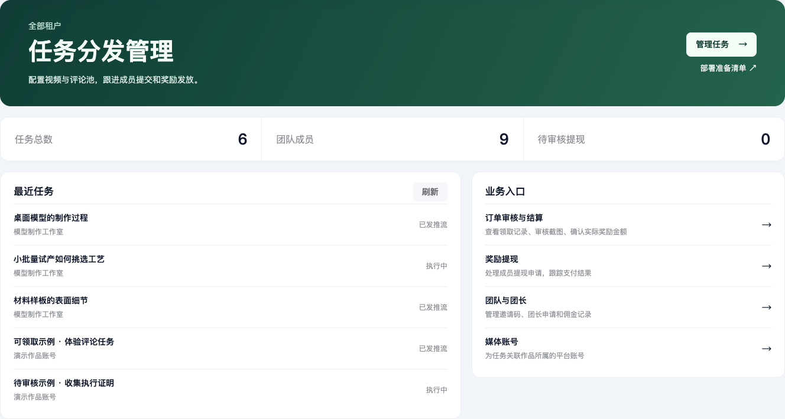
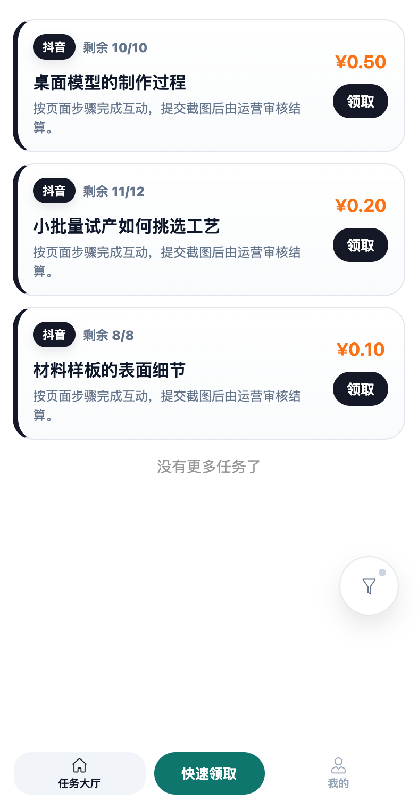
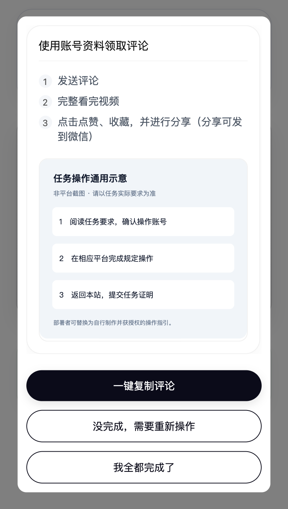
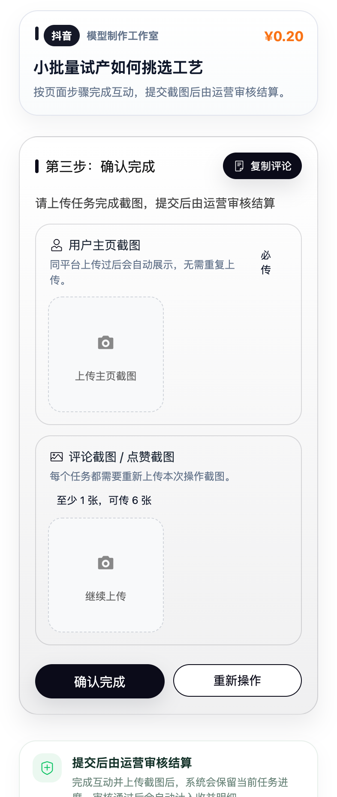

# 快火任务分发 · 登录完整版

这份源码可单独部署成一套任务分发系统。发布者和审核人员使用专门的 PC 管理后台，成员使用手机 H5。两端共用一个任务服务、PostgreSQL 数据库和 Redis。运行它无需原五项目套件。

## 先看界面

[](docs/screenshots/admin-dashboard.png)

| 成员选任务 | 领评论时的操作指引 | 提交任务证明 |
| --- | --- | --- |
| [](docs/screenshots/member-hall.png) | [](docs/screenshots/member-comment-guide.png) | [](docs/screenshots/member-proof.png) |

以上画面使用本地示例任务。点击图片可放大。[完整图集含成员登录、打开作品和后台结算](docs/screenshots/README.md)。

## 启动与登录

准备已启动的 Docker Engine、Compose v2、Python 3.9+ 和浏览器。首次构建需要联网下载依赖。把本目录单独复制或解压，在此运行：

```sh
python3 run.py
```

Windows 用 `py -3 run.py`。后台入口为 **http://127.0.0.1:8781/task-management**，成员入口为 **http://127.0.0.1:8782/**。首次启动自动生成本机随机密钥和后台密码，保存在 `.local/deploy.env`。成员独立通过手机验证码或已接入的微信授权进入 H5。

在本机走流程时，管理员使用私有配置里的 `SEED_ADMIN_USERNAME` 和 `SEED_ADMIN_PASSWORD` 登录后台。成员在 H5 点「获取验证码」，默认的模拟短信会在页面自动填入验证码。新部署从空任务列表开始，可按下方「跑通第一笔任务」创建自己的示例。

如果希望自己安装 Node.js、数据库和 Redis，按[部署指南的原生启动步骤](full-stack/docs/DEPLOYMENT.md)运行。应用使用全新的任务专用库。公网域名、真实短信、公众号与商户资料只在启用相应能力时准备。[部署与外部服务清单](full-stack/docs/INTEGRATIONS.md)

## 管理台能做什么

| 页面 | 管理工作 |
| --- | --- |
| 任务工作台 | 查看任务、成员和待审提现，从同一入口进入各项管理工作和部署准备说明 |
| 每日任务 | 建立作品和媒体账号关系、配置金额与投放范围、维护评论池、导入导出、发布、暂停和复制分发入口 |
| 订单审核与结算 | 查看成员领取记录、主页截图和本次执行证明，写明原因退回补交，或确认实际金额并记入成员钱包 |
| 团队与团长 | 管理团队邀请码、团长绑定、申请和佣金记录；在指定团队的任务上配置分佣 |
| 成员与媒体账号 | 维护任务成员状态和业务资料，管理分发任务关联的平台账号 |
| 奖励提现 | 查看成员提现申请和状态，审核、查单、核对微信收款结果 |
| 租户和后台权限 | 管理业务空间、操作员、角色和访问权限；成员业务数据归属相应租户 |

成员 H5 提供资料补全、邀请码/团长码、任务账号切换、领任务、领评论、提交两类图片、驳回后补交、查看记录、钱包、团长中心和提现。

手机任务大厅展示作品、剩余名额和奖励。进入一项任务后，「开始助推」「领取评论」「确认完成」在同一执行页分步显示。打开作品和复制评论各有独立弹窗，教学图支持点开查看。页面布局、按钮和样式包含在[成员端源码](full-stack/member/README.md)中。部署者可以[为不同平台和手机配置自己的教学图](full-stack/docs/DEPLOYMENT.md#配置手机操作弹窗的教学图)。

## 跑通第一笔任务

1. **备好材料。** 准备一个可打开的作品链接、要分发的评论（每条一行）、领取人数、每份奖励、可领取的团队或成员范围。初次体验可以使用示例作品账号，先在「团队与团长」建一个团队并取得成员邀请码。
2. **发布。** 管理员选择业务租户，在「每日任务」新建任务，填入上述信息并保存。创建表单里的「任务金额」以分为单位，例如 250 表示 2.50 元。补足评论池后点「发布」并确认，再复制生成的 H5 链接。
3. **领取和交付。** 用另一个浏览器窗口打开链接，以成员身份登录，初次按提示补齐资料并输入邀请码。成员在所分享的任务里领视频、领评论，完成任务后上传主页截图和执行证明。本机演练可使用 [示例主页图](examples/example-home.png) 和 [示例证明图](examples/example-proof.png)。
4. **核对金额。** 回到后台「订单审核与结算」，打开待审核记录，看清两类图片再操作。可写明原因退回补交，或在「结算金额」中按**元**输入 2.50 并确认。让同一成员打开「钱包」，核对余额及流水。正式打款还需走下面的提现流程。

## 奖励流程

审核订单 → 确认实际结算金额 → 成员钱包入账 → 成员申请提现 → 提现审核 → 微信商家转账 → 成员按需确认收款 → 验签回调或查单确认终态。示例环境使用模拟短信与模拟支付。本地账本的入账金额可以验收，真实到账需要商户在自己的微信环境验收。

## 源码导航

- [专用管理后台](full-stack/admin/README.md)
- [成员 H5](full-stack/member/README.md)
- [任务服务与数据库](full-stack/backend/README.md)
- [本地配置模板](full-stack/deploy.example.env)
- [部署步骤、域名与端口](full-stack/docs/DEPLOYMENT.md)
- [公众号、短信、商户与真机验收](full-stack/docs/INTEGRATIONS.md)
- [本地验证范围](full-stack/docs/VERIFICATION.md)

本版从[快火五项目公开源码](https://github.com/Chen9527-24/kuaihuo-operations-suite)提取真实任务业务，附独立数据模型、迁移和后台入口。按 [PolyForm Noncommercial 1.0.0](LICENSE) 许可分发，商业用途需另行取得授权。[中文许可说明](LICENSE.zh-CN.md) · [署名](NOTICE)
