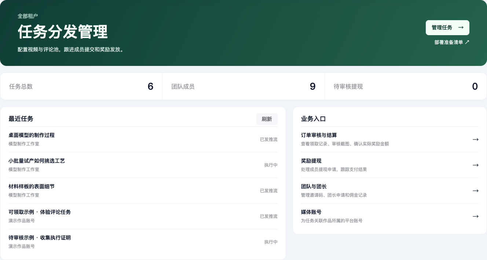
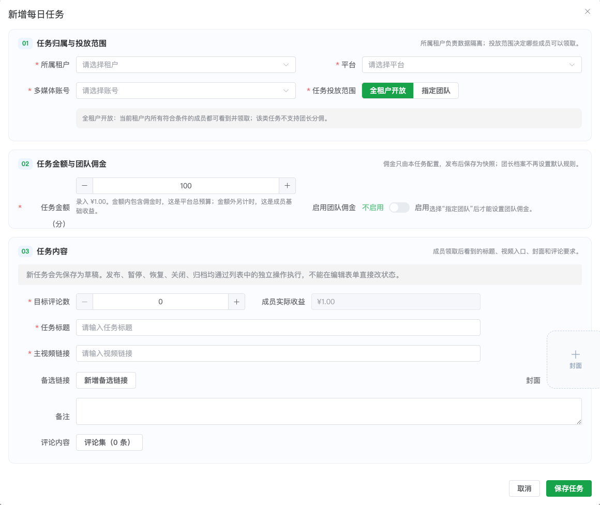
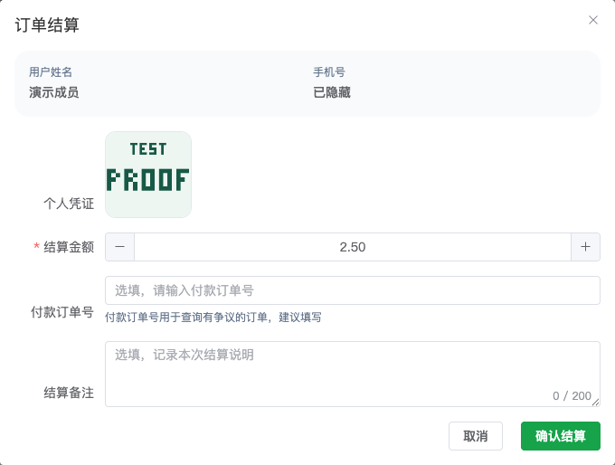
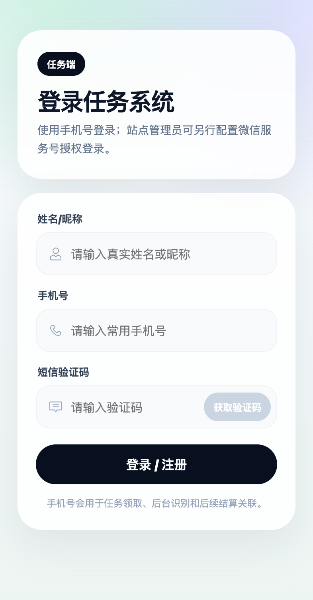
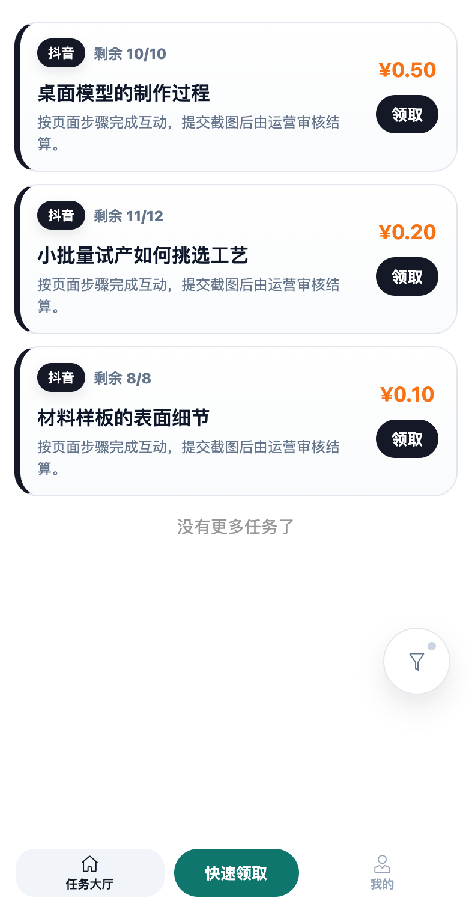
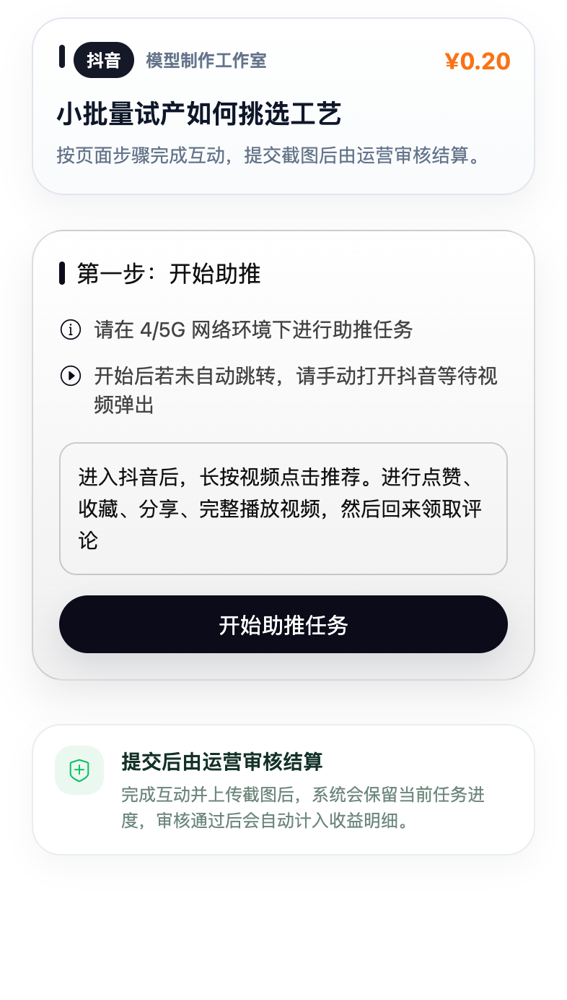
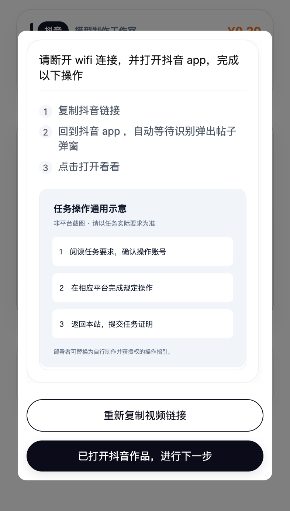
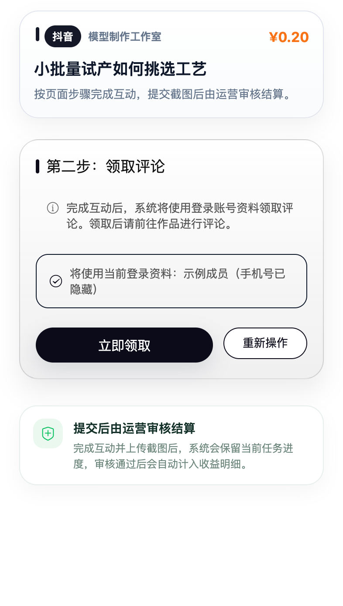
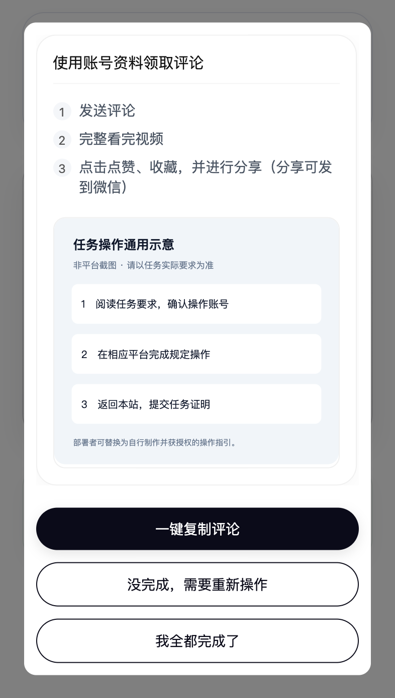
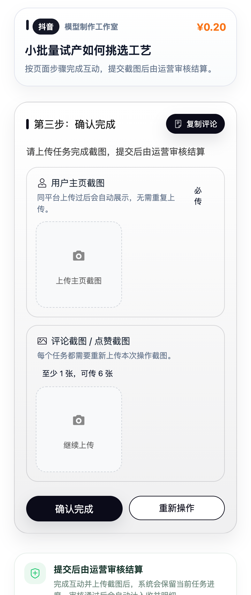

# 登录完整版界面图集

这些截图取自本机运行的 PC 后台与手机尺寸 H5。任务、人员和金额均为演示数据。点击缩略图可查看原图。

## 管理员发布与审核

发布者从工作台进入「任务与评论池」，点击「新增」打开下方表单。先选择作品所属的业务租户、平台和媒体账号，然后填写分发范围、任务金额、名额、视频链接与评论。保存并正式发布后，可从列表复制成员领取链接。

成员提交证明后，审核人员从「订单审核与结算」查看订单。

审核员在弹窗里打开本次执行凭证，并核对以元为单位的结算金额。确认后生成成员钱包流水。若要发放真实微信零钱，成员还要申请提现，部署方需自行开通并验证微信商家转账。[提现与外部服务准备](../../full-stack/docs/INTEGRATIONS.md)

## 成员登录和选择任务

| 手机登录 | 任务大厅 |
| --- | --- |
|  |  |

首次进入时按页面提示补齐资料并绑定团队。大厅按成员可领取的范围展示作品、剩余数量和单笔奖励。打开某项任务的定向分享链接后，登录与入组完成会返回该任务。

## 打开作品、领取评论和交付

| 领取后查看作品信息 | 打开作品操作指引 | 使用当前资料领取评论 |
| --- | --- | --- |
|  |  |  |

| 复制分配的评论 | 上传任务证明 |
| --- | --- |
|  |  |

两个操作弹窗展示源码默认的通用教学图，部署者可以按平台和设备替换为自己的材料。成员按页面要求提交主页截图及本次执行证明，同一平台已保存的主页图可复用。[教学图配置](../../full-stack/member/docs/CONFIGURATION.md#操作弹窗的教学图) · [返回登录版说明](../../README.md)
