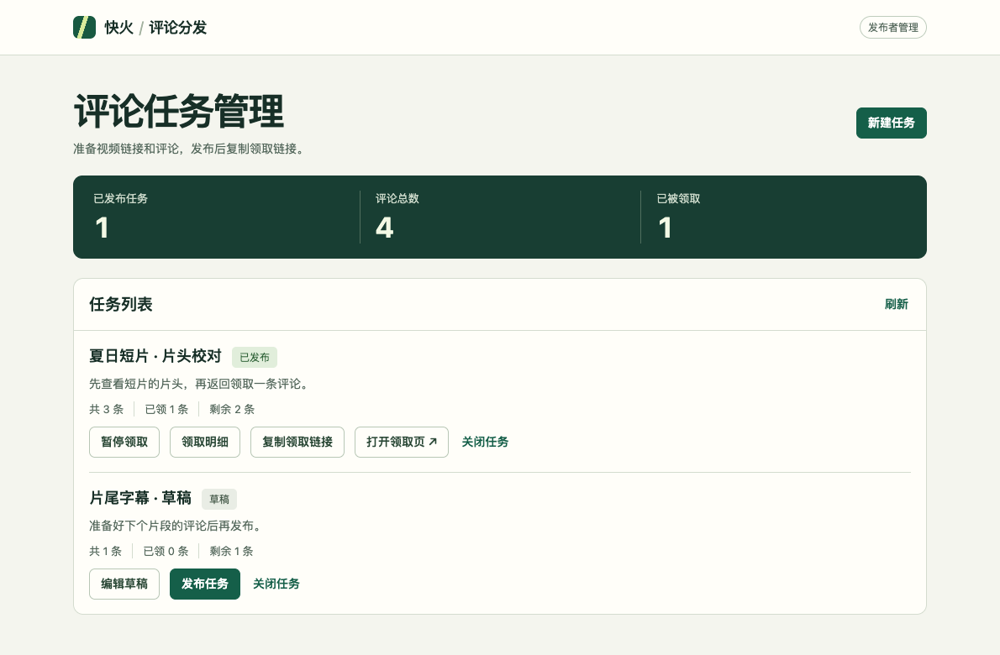
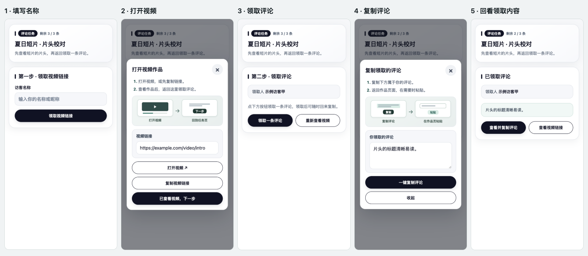

# 快火评论分发 · 免登录版

这是一套可以在本机独立运行的评论分发工具，适合分配预先写好的评论文案和演练手机领取流程。发布者录入作品链接和评论池，为每个任务生成独立的领取地址。访客只填写名称，先领视频，再领一条评论。页面提供打开作品和复制评论的操作指引。复制后即可结束，无需账号、手机号或完成截图。发布者可以按任务查看每位访客领取到哪一步。

[查看发布者与访客界面](#界面截图) · [跟着样例走一遍](#用本机示例视频和两条评论体验一次) · [非商业许可](LICENSE)

## 启动

准备 Python 3.9 或更高版本和现代浏览器。下载仓库并解压，或用以下命令取得源码，再进入包含 `run.py` 的 `no-login-version` 目录。若下载的是单独的免登录版压缩包，直接进入解压后的同名目录即可。程序只依赖 Python 自带模块，首次启动自动建立本地数据库和管理密钥。

```sh
git clone https://github.com/Chen9527-24/kuaihuo-task-dispatch.git
cd kuaihuo-task-dispatch/no-login-version
```

| 系统 | 启动命令 |
| --- | --- |
| macOS、Linux | `python3 run.py` |
| Windows | `py -3 run.py` |

保持终端打开，复制终端显示的**发布者管理地址**到浏览器。该地址带本机生成的管理密钥，供发布者保存。把页面上为某项任务生成的**领取链接**发给体验者。两个地址的用途不同。

默认端口为 **8780**。如果已被占用，在启动命令末尾加 `--port 8899`。按 Ctrl+C 可停止服务。

**访问范围。** 当前启动器监听 `127.0.0.1`，服务端只接受本机地址。可在同一台电脑上用不同浏览器或独立无痕窗口体验多名访客。把本机领取地址发给朋友后，对方手机上的 `127.0.0.1` 指向手机自身。若要对外提供多人服务，需要另行适配访问域名及来源校验，并配置 HTTPS 网关和发布者入口保护。

## 界面截图

以下画面来自独立的本地实例，使用虚构任务和示例访客。视频栏中的 `example.com` 用于演示表单，后面的操作教程使用随包视频即可实际播放。

**发布者工作台。** 在同一页面创建任务、发布或暂停领取、复制领取链接，并查看评论总量、已领数和余量。



发布时，每行评论对应一个领取名额。发布后可在领取明细中分别看到「已领取视频链接」和「已领取评论」。[查看新建任务表单](docs/screenshots/publisher-create.png) · [查看领取明细](docs/screenshots/publisher-claims.png)

**访客领取流程。** 从分享页填写名称，领视频并查看，再手动领评论。收起弹窗后仍可回看同一条文案。



查看单张大图：[填写名称](docs/screenshots/visitor-start.png) · [打开视频](docs/screenshots/video-guide.png) · [领取评论](docs/screenshots/claim-comment.png) · [复制评论](docs/screenshots/comment-guide.png) · [回看已领内容](docs/screenshots/visitor-receipt.png)

## 用本机示例视频和两条评论体验一次

1. **发布前备好材料。** 项目自带练习视频。默认端口下，它的地址是 `http://127.0.0.1:8780/static/example-video.mp4`。如果启动时改了端口，请相应改掉链接中的 8780。准备两条示例评论，每行一条。

   ```text
   片头的标题清楚可见。
   手机上也能读清画面文字。
   ```

2. **建任务并分享。** 在发布者管理页点「新建任务」。标题填「本地视频体验」，执行要求填「先打开视频，再复制一条评论到自己的记事本」。点「填入本地示例视频」，页面会按当前端口填好视频地址。在「评论池」粘贴两条文字。点「保存草稿」，再点任务上的「发布任务」和「复制领取链接」。
3. **先领视频。** 在同一电脑另开一个浏览器，打开分享链接，填访客名称（例如「体验者甲」）并点「领取视频链接」。在「打开视频作品」弹窗中点「打开视频」或「复制视频链接」。看完返回后点「已查看视频，下一步」。如中途收起弹窗，可点「查看视频链接」重新打开。此时还未分配评论。
4. **再领评论。** 点「领取一条评论」，在弹窗中查看自己的文案，点「一键复制评论」。浏览器未授予剪贴板权限时，可长按或使用系统复制。点「收起」即可结束。刷新或稍后用同一浏览器重开链接，仍可回看视频和自己的评论。
5. **再用一个访客验证。** 在另一个浏览器配置文件或独立无痕会话打开同一链接，用「体验者乙」依次领视频和评论。乙会领到另一条文字。一个浏览器的多个普通标签页通常共用同一访客身份。
6. **发布者核对。** 回管理页刷新，查看任务的已领数量，再点「领取明细」，核对访客名称及领取进度。两条发完后，新的访客会看到领完提示。换用自己的视频时，在新任务中填入自己有权分享的完整 HTTP 或 HTTPS 视频地址即可。

## 领取规则

- 创建草稿后可继续编辑。发布时须有一个有效视频链接和至少一条评论。每个任务最多 1000 条文案，每条最多 2000 字，同一任务中的文案需互不重复。
- 初次访问只显示任务信息。领取者名称为 1 至 32 个可显示字符，可以用昵称。填写名称并领视频会登记这名访客，评论名额在下一步点击领评论时才占用。若两步之间评论被其他人领完，仍能回看视频。
- 每个浏览器访客对每项任务可领一条评论，同一条只分配一次。分配依据是浏览器的访客 Cookie，即使碰巧同名，不同浏览器也各算一名访客。在同一浏览器更换名称不会开出第二次领取机会。
- 暂停后停止新的领取，恢复后有余量时可继续领。关闭后不再开放。已经领到的视频或评论在原浏览器仍能回看。这里的已领数量表示文案分配记录。

## 数据与备份

访客 Cookie 有效期为 365 天。清除站点数据、更换浏览器或结束无痕会话后，系统可能会将使用者视为新访客。访客名称、任务和领取记录保存在 `.local/comments.sqlite3`。发布者管理会话有效 7 天，到期可以再次打开终端显示的管理地址。

备份时先停止服务，再复制整个 `.local` 目录。换电脑分享源码时分发源码包，把自己的数据目录和管理地址留在本机。使用 `--data-dir 路径` 可指定数据目录，重启时沿用同一路径。

## 弹窗教学图

本地示例视频和普通视频链接使用随页面提供的两幅示意，分别说明打开视频和复制评论。点示意可放大。部署者也可以在数据目录的 `task-guides/` 放入自己的平台教学图，服务会按已领取的视频链接和访问设备选图。无需修改代码或安装依赖。

| 视频链接对应的平台 | 打开作品 · iPhone | 打开作品 · Android 或桌面 | 复制评论 |
| --- | --- | --- | --- |
| 抖音 | `dy-ios.png` | `dy-android.jpg` | `dy1-ios.png` |
| 小红书 | `xhs-ios.png` | `xhs-android.png` | `xhs-comment.png` |

默认目录是 `.local/task-guides/`。只填写有相应素材的项目，缺图仍显示通用指引。这些图片供访客读取，应使用自己有权展示、适合公开的内容。访客全程只查看或复制，页面没有提交图片的步骤。

## 源码与许可

| 位置 | 内容 |
| --- | --- |
| `run.py`、`server.py` | 本机启动入口、发布者入口与访客请求 |
| `domain.py` | 任务、评论池、领取规则与数据库操作 |
| `static/` | 发布者页面、领取页面、本地样式和练习视频 |
| `docs/screenshots/` | 发布者管理台与访客领取流程的公开截图 |
| `tests/` | 评论分配与本地服务的测试 |

在本目录可用 `python3 -B -m unittest discover -s tests -v` 运行测试。Windows 将 `python3` 换为 `py -3`。

评论池和逐条领取取自快火原任务分发业务，独立版使用本地 SQLite 保存任务与领取记录。[原业务说明](https://github.com/Chen9527-24/kuaihuo-operations-suite/blob/850902f4575e20c1839fc211494246fecec90414/docs/features/TASK_DISTRIBUTION.md)

本项目采用 PolyForm Noncommercial License 1.0.0。分发时保留许可与署名，商用需另行获得授权。[完整许可](LICENSE) · [中文说明](LICENSE.zh-CN.md) · [署名声明](NOTICE)
